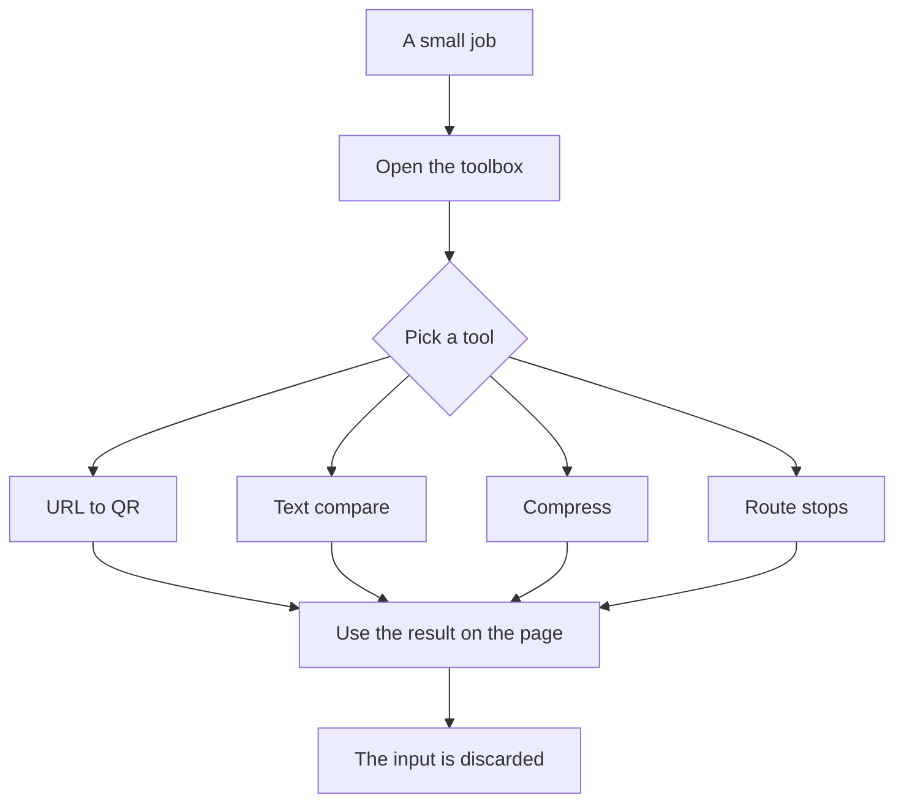

# Toolbox

A place for small jobs that usually end up in a spare browser tab. You open the box, pick a tool, and the result shows up on the same page.

The input exists only to make that result. Text and files are discarded when the response is sent. There is no account, no history, and no saved uploads.

**URL to QR** turns a link into a code you can download, with an optional logo in the center.

**Text compare** shows the lines that changed between two texts.

**Compress** makes a JPEG, PNG, or PDF smaller so it is easier to send.

**Route stops** lists petrol stations, food, cafes, or mosques along a drive, and says which are easy to stop at. To find them, the start and destination are sent to OpenStreetMap's public services. They are not stored or logged here.
